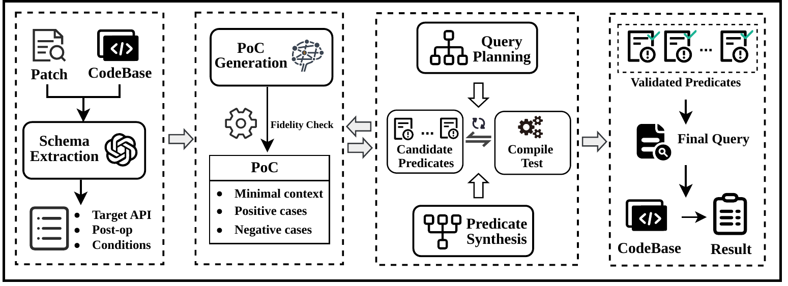

# QLM 

Project page (Notion): [CodeQL Query Synthesis For Detecting Linux Bugs](https://app.notion.com/p/CodeQL-Query-Synthesis-For-Detecting-Linux-Bugs-228feb6e10728351ac7b815497c35bae)

## Abstract

Automating the synthesis of CodeQL vulnerability detectors from bug-fix patches is an
appealing alternative to manual query authoring, but using LLM to generate queries in a
single monolithic pass frequently compiles yet fails to generalize beyond the seed
instance. We present QLM, a compositional synthesis framework that tackles this problem
along two axes. First, QLM constructs a minimal Proof-of-Concept (PoC) program from each
patch and gates it through a deterministic structural verifier that checks feature counts
against the original bug-relevant slice, producing a faithful oracle for the synthesis
loop. Second, a top-down planner decomposes each query into atomic predicates whose
correctness is validated individually against the PoC before the full query is
assembled. Predicates that miss known-buggy cases or fire on safe cases are rejected and
refined with targeted diagnostic feedback. On the Linux kernel, QLM discovered 49
previously unknown vulnerabilities, of which 5 have been confirmed by maintainers and 17
merged upstream, while another 10 were fixed by other developers; these 32 already fixed
or confirmed bugs had persisted undetected for a median of 8.3 years (up to 15.3 years).
On KBH-Bench, a new benchmark of 500 ground-truth kernel bug-fix commits, QLM raises
normalized recall 2.6× over a monolithic baseline (5.6% → 14.8%) and doubles
analyze-survival on the full kernel database (46% → 92%).

## Overview



Given a seed bug-fix patch, QLM first extracts a bug schema that captures the semantic
obligation restored by the patch. It then synthesizes a compact PoC containing buggy and
safe cases, checks it against the seed with a structural fidelity check, and compiles it into a lightweight CodeQL database.
Top-down query planning translates the schema into a query skeleton and a set of
predicate specifications; the predicates are then generated bottom-up, each validated by
compilation and PoC execution, and assembled into the final query, which is run on the
full codebase.

QLM synthesizes CodeQL queries that detect a bug pattern, using a
single bug-fix commit (the *seed*) as the specification. This artifact
lets you inspect the exact prompts, the queries the LLM produced, and
the scoring metrics behind the paper's tables — and gives you the
scripts to re-run the scoring pipeline once the (large, regenerable)
CodeQL databases are rebuilt locally.

## Linux kernel findings (RQ1)

QLM-synthesized queries found **49 previously unknown bugs** in mainline Linux (v6.19-rc), status as of 2026-11-20. Reports from different queries were deduplicated by source location, so each bug is counted once; one function can hold several bugs (e.g. two separate leaks). Lifetime is measured from the commit that introduced the bug (found with `git blame`, the patch's `Fixes:` tag) to our fix. The full list is also in [`data/rq1-findings.csv`](data/rq1-findings.csv).

| Status | Bugs |
|---|---:|
| Fixed — our patch merged upstream | 17 |
| Confirmed by maintainer | 5 |
| Fixed upstream by another developer | 10 |
| Patch under LKML review | 11 |
| Pending — patch prepared, not yet sent | 6 |
| **Total** | **49** |

The 32 bugs that are fixed or confirmed had persisted for a median of 8.3 years (up to 15.3).

| Bug type | Bugs |
|---|---:|
| Refcount leak | 27 |
| Unbounded buffer accumulation | 5 |
| Integer overflow | 5 |
| Out-of-bounds index | 4 |
| Memory leak | 2 |
| sysfs buffer overflow | 2 |
| ERR_PTR dereference | 2 |
| Sleep in atomic context | 1 |
| Out-of-bounds read | 1 |

### Fixed — our patch merged upstream (17)

| No. | File | Function | Bug type | Introduced | Lifetime (y) |
|---:|---|---|---|---:|---:|
| 1 | `drivers/video/of_display_timing.c` | `of_get_display_timings` | Refcount leak | 2012 | 13.3 |
| 2 | `arch/arm/mach-imx/src.c` | `imx_src_init` | Refcount leak | 2013 | 13.3 |
| 3 | `arch/arm/mach-imx/src.c` | `imx7_src_init` (first lookup) | Refcount leak | 2021 | 5.1 |
| 4 | `arch/arm/mach-imx/src.c` | `imx7_src_init` (second lookup) | Refcount leak | 2021 | 5.1 |
| 5 | `scripts/tracepoint-update.c` | `add_string` | Memory leak | 2025 | 0.3 |
| 6 | `drivers/greybus/gb-beagleplay.c` | `hdlc_tx_frames` | Sleep in atomic context | 2023 | 2.7 |
| 7 | `drivers/media/cec/platform/stm32/stm32-cec.c` | `stm32_rx_done` | Out-of-bounds index | 2017 | 9.0 |
| 8 | `drivers/mtd/parsers/ofpart_core.c` | `parse_fixed_partitions` | Refcount leak | 2021 | 4.7 |
| 9 | `drivers/of/base.c` | `of_alias_scan` | Refcount leak | 2011 | 14.4 |
| 10 | `drivers/pinctrl/pinctrl-single.c` | `pcs_add_gpio_func` | Refcount leak | 2012 | 13.5 |
| 11 | `drivers/soc/samsung/exynos-pmu.c` | `exynos_get_pmu_regmap` | Refcount leak | 2017 | 9.4 |
| 27 | `arch/arm/mach-versatile/platsmp-vexpress.c` | `vexpress_smp_dt_prepare_cpus` | Refcount leak | 2013 | 13.0 |
| 28 | `arch/arm/mach-versatile/v2m.c` | `vexpress_flags_set` | Refcount leak | 2014 | 12.4 |
| 33 | `drivers/media/rc/fintek-cir.c` | `fintek_get_rx_ir_data` | Unbounded buffer accumulation | 2011 | 15.3 |
| 34 | `drivers/mtd/parsers/qcomsmempart.c` | `parse_qcomsmem_part` (offset) | Integer overflow | 2021 | 5.7 |
| 35 | `drivers/mtd/parsers/qcomsmempart.c` | `parse_qcomsmem_part` (size) | Integer overflow | 2021 | 5.7 |
| 42 | `drivers/thermal/sprd_thermal.c` | `sprd_thm_probe` | Out-of-bounds index | 2020 | 6.6 |

### Confirmed by maintainer (5)

| No. | File | Function | Bug type | Introduced | Lifetime (y) |
|---:|---|---|---|---:|---:|
| 21 | `arch/arm/mach-mstar/mstarv7.c` | `mstarv7_boot_secondary` | Refcount leak | 2020 | 5.5 |
| 22 | `arch/arm/mach-mstar/mstarv7.c` | `mstarv7_init` | Refcount leak | 2020 | 5.9 |
| 23 | `drivers/bus/ti-sysc.c` | `sysc_init_static_data` | Refcount leak | 2017 | 8.3 |
| 24 | `drivers/bus/vexpress-config.c` | `vexpress_syscfg_probe` | Refcount leak | 2020 | 6.2 |
| 25 | `tools/objtool/elf.c` | `elf_alloc_reloc` | Memory leak | 2016 | 9.9 |

### Fixed upstream by another developer (10)

| No. | File | Function | Bug type | Introduced | Lifetime (y) |
|---:|---|---|---|---:|---:|
| 12 | `drivers/thermal/thermal_of.c` | `thermal_of_cm_lookup` | Refcount leak | 2025 | 0.9 |
| 13 | `arch/arm/mach-imx/avic.c` | `mxc_init_irq` (fsl,avic node) | Refcount leak | 2012 | 14.0 |
| 14 | `drivers/memory/emif.c` | `of_get_memory_device_details` | Refcount leak | 2012 | 13.8 |
| 15 | `drivers/bus/ti-sysc.c` | `sysc_init_stdout_path` | Refcount leak | 2017 | 8.3 |
| 16 | `arch/arm/mach-imx/avic.c` | `mxc_init_irq` (fsl,imx25-ccm node) | Refcount leak | 2018 | 8.3 |
| 17 | `arch/arm/mach-tegra/irq.c` | `tegra_init_irq` | Refcount leak | 2015 | 11.2 |
| 18 | `arch/arm/mach-tegra/irq.c` | `tegra114_gic_cpu_pm_registration` | Refcount leak | 2013 | 12.9 |
| 19 | `drivers/platform/chrome/cros_ec_typec.c` | `cros_typec_register_partner_pdos` (sink caps) | Unbounded buffer accumulation | 2022 | 3.8 |
| 20 | `drivers/platform/chrome/cros_ec_typec.c` | `cros_typec_register_partner_pdos` (source caps) | Unbounded buffer accumulation | 2022 | 3.8 |
| 43 | `drivers/iio/imu/bno055/bno055.c` | `BNO055_SCAN_CH_COUNT` | Unbounded buffer accumulation | 2022 | 3.4 |

### Patch under LKML review (11)

| No. | File | Function | Bug type | Introduced | Lifetime (y) |
|---:|---|---|---|---:|---:|
| 26 | `arch/arm/mach-alpine/alpine_cpu_pm.c` | `alpine_cpu_pm_init` | Refcount leak | 2015 | 11.5 |
| 29 | `drivers/bus/ti-sysc.c` | `sysc_exit` (module unload) | Refcount leak | 2017 | 8.3 |
| 30 | `drivers/firmware/trusted_foundations.c` | `of_register_trusted_foundations` | Refcount leak | 2013 | 12.6 |
| 31 | `drivers/iio/adc/xilinx-ams.c` | `ams_init_module` | Unbounded buffer accumulation | 2021 | 4.8 |
| 32 | `drivers/mailbox/omap-mailbox.c` | `omap_mbox_probe` | Refcount leak | 2014 | 11.3 |
| 36 | `drivers/net/ethernet/freescale/fman/fman.c` | `fman_set_port_params` (LIODN tables) | Out-of-bounds index | 2015 | 10.8 |
| 37 | `drivers/net/ethernet/freescale/fman/fman.c` | `fman_set_port_params` (MAC tables) | Out-of-bounds index | 2015 | 10.8 |
| 38 | `drivers/soc/dove/pmu.c` | `dove_init_pmu` (domains_node) | Refcount leak | 2015 | 10.9 |
| 39 | `drivers/soc/dove/pmu.c` | `dove_init_pmu` (np_pmu) | Refcount leak | 2015 | 10.9 |
| 40 | `drivers/soundwire/master.c` | `clock_frequencies_show` | sysfs buffer overflow | 2020 | 6.4 |
| 41 | `drivers/soundwire/master.c` | `clock_gears_show` | sysfs buffer overflow | 2020 | 6.4 |

### Pending — patch prepared, not yet sent (6)

| No. | File | Function | Bug type | Introduced | Lifetime (y) |
|---:|---|---|---|---:|---:|
| 44 | `drivers/mtd/nand/raw/diskonchip.c` | `inftl_partscan` (offset) | Integer overflow | 2005 | 21.4 |
| 45 | `drivers/mtd/nand/raw/diskonchip.c` | `inftl_partscan` (size) | Integer overflow | 2005 | 21.4 |
| 46 | `drivers/mtd/nand/raw/diskonchip.c` | `nftl_partscan` (size) | Integer overflow | 2005 | 21.5 |
| 47 | `drivers/mtd/nand/raw/nand_toshiba.c` | `toshiba_nand_benand_read_eccstatus_op` | ERR_PTR dereference | 2020 | 6.5 |
| 48 | `drivers/thermal/ti-soc-thermal/ti-thermal-common.c` | `ti_thermal_report_sensor_temperature` | ERR_PTR dereference | 2012 | 14.2 |
| 49 | `sound/usb/midi.c` | `find_usb_ijack` | Out-of-bounds read | 2024 | 2.6 |


## Directory layout

```
qlm-artifact/
├── README.md                  # this file
├── figures/
│   └── overview.png           # QLM workflow (paper Fig. overview)
├── data/
│   ├── seeds/                 # 25 seeds × 5 patterns (metadata only)
│   │   ├── seeds.json
│   │   └── seeds.csv
│   ├── generated-queries/     # LLM-generated CodeQL queries + audit logs
│   │   ├── C0/  (125 .ql + 125 .audit.json)   # monolithic baseline
│   │   ├── C1/  (120 .ql + 121 .audit.json)   # monolithic + PoC
│   │   ├── C2/  (125 .ql + 125 .audit.json)   # compositional
│   │   ├── C3/  (124 .ql + 125 .audit.json)   # QLM (full pipeline)
│   │   ├── L0/  (123 .ql + 125 .audit.json)   # RQ4 zero-shot
│   │   └── L1/  ( 63 .ql +  63 .audit.json)   # RQ4 mono + compile self-fix
│   ├── kbh-bench/             # KBH-Bench: 500 ground-truth fix commits (390 in-DB)
│   │   ├── README.md
│   │   ├── kbh-bench.csv      # one row per commit, with in_db flag
│   │   └── ground-truth/      # per-pattern GT JSON read by the scorer
│   ├── rq1-findings.csv       # the 49 Linux kernel bugs found in RQ1
│   ├── schemas/               # bug schema definition + 125 C3 schema instances
│   │   ├── README.md
│   │   └── instances/  (125 .json)
│   └── scoring/               # D4 aggregate metrics
│       ├── C{0,1,2,3}-<pattern>.json          # 4 cells × 5 patterns = 20
│       └── run-summary.json                   # top-level 20-cell matrix
└── code/
    ├── prompts/               # LLM prompt templates (Markdown)
    │   ├── C0-prompt.md       # RQ2/RQ3 cells
    │   ├── C1-prompt.md
    │   ├── C2-prompt.md
    │   ├── C3-prompt.md       # = QLM full pipeline
    │   ├── L0-prompt.md       # RQ4 zero-shot compositional
    │   ├── L1-prompt.md       # RQ4 monolithic + compile self-fix
    │   └── L3-prompt.md       # RQ4 closed-list surgical edits (future work)
    ├── qlm/                          # generation pipeline: python3 -m qlm (see its README)
    ├── scoring/
    │   ├── score-cell-pattern.py     # per (cell, pattern) scorer
    │   ├── run-d4-batched.sh         # pattern-serial × 5-parallel driver
    │   ├── orphan-watchdog.sh        # subprocess-lifecycle safety net
    │   └── recover-from-workdir.py   # partial-recovery aggregator
    └── verifier/                     # seed↔PoC structural fidelity check (see its README)
        ├── verifier.py               # API derivation + verdict rules
        ├── run_verifier.py           # CLI entry point
        ├── ql/                       # CodeQL feature-count query
        └── seeds/                    # 25 verbatim seed slices + fix patches
```

## How to re-run the scoring pipeline

**Prerequisites**

- Docker + docker-compose (the pipeline runs in a container with GCC, Python 3, and the CodeQL CLI).
- CodeQL CLI 2.25.6 (2.23.0 for the legacy databases; see the
  supplementary material for the CLI-vs-DB version matrix).
- An LLM API endpoint compatible with the `claude-opus-4` series — only needed to regenerate
  queries, not to re-score the ones already shipped here.

**Steps**

```bash
# 1. Rebuild the ground-truth CodeQL databases from your local Linux
#    tree at tag v6.19-rc5. See the paper for the KCFLAGS / EDG
#    workarounds required for full extractor coverage.
codeql database create <REPO_ROOT>/codeql-dbs/linux-<version>-arm-am \
  --language=cpp --command="make -j$(nproc) ARCH=arm allmodconfig ..."

# 2. Regenerate the 126 pair-wise mini-DBs (script in supplementary).

# 3. (Optional) Regenerate the LLM queries.
#    For each (cell, seed, repeat) triple, invoke the LLM with the
#    corresponding code/prompts/<cell>-prompt.md, substituting the seed
#    metadata from data/seeds/seeds.json. The prompt files encode the
#    exact stage-by-stage protocol (features -> PoC -> plan ->
#    per-predicate validation -> assembly). Skip this to score the
#    queries already in data/generated-queries/.

# 4. Run the scorer.
tmux new-window -n d4       'bash code/scoring/run-d4-batched.sh'
tmux new-window -n watchdog 'bash code/scoring/orphan-watchdog.sh'
# Wall time ~13 h on a 20-core machine.

# 5. Read the aggregates.
#    The scorer writes data/scoring/<cell>-<pattern>.json; the paper's
#    Tables 2-4 are built from these plus run-summary.json.
```

## Licence

Code and prompts in this artifact are released under the licence in the
accompanying `LICENCE` file (added when the artifact is released
publicly). Bug-fix commit metadata (seed SHAs, subjects, file paths) is
derived from public upstream Linux kernel commits and is available in
[`data/seeds/seeds.json`](data/seeds/seeds.json).
